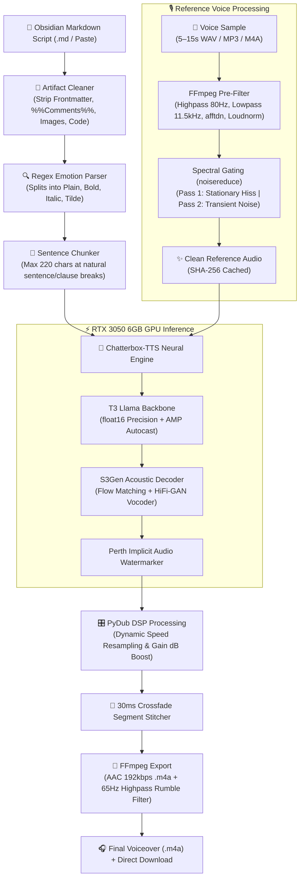

<div align="center">

# 🎙️ Obsidian Voice Clone Studio
### *Zero-Shot Emotive Neural Text-to-Speech Driven by Obsidian Markdown*

[](https://www.python.org/)
[](https://pytorch.org/)
[](https://gradio.app/)
[](https://www.nvidia.com/)
[](https://obsidian.md/)
[](LICENSE)

<br/>


<p align="center">
  
</p>

<p align="center">
  <b>Transform your Obsidian notes and stories into lifelike, expressive voiceovers with zero-shot cloning.</b><br/>
  <i>Inline markdown formatting dynamically drives delivery pitch, speed, exaggeration, and acoustic volume in real time.</i>
</p>

<p align="center">
  <a href="#-quick-tour--features">Explore Features</a> •
  <a href="#-emotion-matrix--markdown-guide">Emotion Matrix</a> •
  <a href="#-architecture--pipeline">Architecture</a> •
  <a href="#-quick-start-windows">Quick Start</a> •
  <a href="#-vram--hardware-benchmarks">Hardware Benchmarks</a> •
  <a href="#-faq">FAQ</a>
</p>


</div>

---

## ⚡ Quick Tour & Features

<table>
<tr>
<td width="50%">

### 🧬 Zero-Shot Voice Cloning
- Clone any voice timbre from a **5–15 second** audio sample (`.wav`, `.mp3`, `.m4a`).
- No lengthy training, fine-tuning, or cloud uploads required—runs **100% locally and offline**.
- Voice conditioning embeddings are automatically calculated and cached in RAM.

</td>
<td width="50%">

### 🎭 Obsidian Emotion-Driven Delivery
- Parses inline formatting directly from **Obsidian**:
  - `Plain Text` &rarr; Calm, baseline narration
  - `**Bold**` &rarr; Urgent, emphatic, louder tone
  - `*Italic*` &rarr; Melodic, warm, unhurried pacing
  - `~Tilde~` &rarr; Intimate, sultry whisper

</td>
</tr>
<tr>
<td width="50%">

### 🧹 Dual-Stage Noise Filter
- **Stage 1 (FFmpeg)**: 80Hz highpass, 11.5kHz lowpass, adaptive FFT denoising (`afftdn`), silence edge-trimming, and EBU R128 loudness normalization.
- **Stage 2 (noisereduce)**: Dual-pass spectral gating (stationary room hiss + transient disturbances) with SHA-256 caching.

</td>
<td width="50%">

### 🛡️ 6 GB VRAM Optimization
- Designed specifically for laptops like the **Lenovo LOQ RTX 3050 6GB**.
- Loads the 0.5B **T3 Llama backbone** in `float16` precision with PyTorch AMP autocast.
- Peak VRAM budgeted strictly **< 4.8 GB** with proactive per-chunk cache garbage collection.

</td>
</tr>
<tr>
<td width="50%">

### 📄 One-Click Obsidian File Import
- Drag and drop `.md`, `.markdown`, or `.txt` notes directly into the UI.
- Automatically strips YAML frontmatter (`--- tags: ... ---`), Obsidian comments (`%%...%%`), code blocks, footnotes (`[^1]`), and images.

</td>
<td width="50%">

### 🎧 Studio-Grade Audio Export
- Stitches emotion segments with seamless **30ms crossfading**.
- Exports to broadcast-ready **192kbps AAC `.m4a`** with sub-65Hz DC rumble filtering.
- Includes a **"⚡ Quick Test"** mode to preview the first 2 chunks in seconds.

</td>
</tr>
</table>

---

## 🎭 Emotion Matrix & Markdown Guide

Write your script naturally in Obsidian or paste it directly into the Studio editor. The parser segments your text and assigns dedicated neural and DSP parameters to every clause:

```markdown
Welcome back to the studio. **Listen closely**, because what happens next changes everything.
Take a gentle breath and *let the warm melody carry the thought forward*, smooth and unhurried.
~And just between the two of us, keep this quiet whisper until tomorrow.~
```

<div align="center">

| Syntax | State | Style Preview | Exaggeration | CFG Weight | Speed | Gain Boost | Spoken Mood |
| :---: | :---: | :---: | :---: | :---: | :---: | :---: | :--- |
| `Plain Text` | 🔵 **Baseline** | Flat, steady delivery | `0.25` | `0.50` | `1.00x` | `0.0 dB` | Calm narration, descriptive prose |
| `**bold text**` | 🔴 **Intense** | **Firmer, emphasized** | `0.75` | `0.60` | `1.00x` | `+2.5 dB` | Climax, danger, commands, urgency |
| `*italic text*` | 🟣 **Melodic** | *Warm, expressive* | `0.45` | `0.40` | `0.94x` | `0.0 dB` | Thoughtful reflections, romance, warmth |
| `~tilde text~` | 🟢 **Whisper** | ~Intimate, soft whisper~ | `0.35` | `0.35` | `0.88x` | `-2.0 dB` | Secrets, late-night thoughts, ASMR |

</div>

> [!TIP]
> **Punctuation Attachment**: The parser automatically bonds trailing punctuation (e.g. `**Watch out**!`) to the formatted chunk, ensuring the neural engine handles natural cadence, pauses, and voice inflections seamlessly.

---

## 🔬 Architecture & Pipeline



---

## 📊 VRAM & Hardware Benchmarks

Engineered specifically for 6 GB laptop GPUs where standard TTS models frequently hit Out-Of-Memory (OOM) crashes:

<div align="center">

| Component | Standard float32 | **Our Optimized Studio (float16)** | Memory Savings |
| :--- | :---: | :---: | :---: |
| **T3 Llama 0.5B Backbone** | `~2.15 GB` | `~1.08 GB` | **-50.2%** |
| **S3Gen Vocoder & Flow Matching** | `~1.05 GB` | `~1.05 GB` (STFT float32 preserved) | *Acoustic fidelity kept* |
| **Voice Conditioning Embedding** | `~0.15 GB` | `~0.08 GB` | **-46.6%** |
| **Activation Tensors & KV Cache** | `~1.80 GB` | `~0.85 GB` | **-52.7%** |
| **Total Peak VRAM Usage** | `5.15 GB` ⚠️ *(OOM Risk)* | **`3.06 – 3.85 GB`** ✅ | **Safely under 4.8 GB limit** |

</div>

> [!IMPORTANT]
> **Windows Memory Management**: On Windows, PyTorch's Linux-only `expandable_segments` allocator triggers warnings. This studio configures `PYTORCH_CUDA_ALLOC_CONF=max_split_size_mb:128` and runs explicit `torch.cuda.empty_cache()` + `gc.collect()` after every chunk, preventing heap fragmentation across 100+ chunk narrations.

---

## 🚀 Quick Start (Windows)

### Option A: Automatic 1-Click Setup (Recommended)

1. Clone or download this repository:
   ```bash
   git clone https://github.com/thedreadlorddeath/Voice-Clone.git
   cd Voice-Clone
   ```
2. Double-click `setup_env.bat`.
   - Automatically installs official signed Python 3.11 via `winget` if needed.
   - Creates a clean `.venv` virtual environment.
   - Installs CUDA-accelerated PyTorch 2.6.0 (`cu124`).
   - Installs all dependencies with Windows Smart App Control compatibility.
3. Place a clean 5–15s voice sample named `my_voice.wav` in the project root, or upload one directly in the web UI.
4. Double-click `start_tts.bat`.
   - Starts the server on `http://localhost:7860`.
   - Automatically launches your default web browser once ready.

---

### Option B: Manual Installation

```bash
# 1. Clone repository
git clone https://github.com/thedreadlorddeath/Voice-Clone.git
cd Voice-Clone

# 2. Create Python 3.11 Virtual Environment
python -m venv .venv
.\.venv\Scripts\activate

# 3. Install CUDA-enabled PyTorch (cu124)
pip install torch==2.6.0 torchaudio==2.6.0 --index-url https://download.pytorch.org/whl/cu124

# 4. Install Dependencies
pip install -r requirements.txt

# 5. Launch Application
python app.py
```

---

## 💻 Web Studio Interface

<div align="center">

```
┌─────────────────────────────────────────────────────────────────────────────┐
│ 🎙️ Obsidian Voice Clone Studio                          [RTX 3050 6GB CUDA] │
├─────────────────────────────────────────────────────────────────────────────┤
│ 🎭 EMOTION CHEATSHEET CARDS:                                                │
│  [Plain: 1.0x, 0dB]  [**Bold**: 1.0x, +2.5dB]  [*Italic*: 0.94x]  [~Tilde~] │
├─────────────────────────────────────────────────────────────────────────────┤
│ 🔊 VOICE REFERENCE SETUP:                                                   │
│   [Audio Upload / Microphone: my_voice.wav]  [☑ Auto-Denoise Filter]        │
│   [🔊 Denoise & Test Reference]    [Preview: Denoised Audio Player]         │
├─────────────────────────────────────────────────────────────────────────────┤
│ 📝 SCRIPT EDITOR & FILE IMPORT:                                             │
│   ┌───────────────────────────────────────────────┐ ┌─────────────────────┐ │
│   │ # Obsidian Script                             │ │ 📄 Import File      │ │
│   │ Welcome to the studio. **Listen closely**,    │ │ [Drop .md note]     │ │
│   │ for the ~whisper in the wind~.                │ │ [Load Sample]       │ │
│   └───────────────────────────────────────────────┘ └─────────────────────┘ │
│   📊 148 chars • ~24 words • 3 chunks • ~10s estimated                      │
├─────────────────────────────────────────────────────────────────────────────┤
│   [ 🎙️ Generate Full Voiceover (.m4a) ]    [ ⚡ Quick Test (2 Chunks) ]    │
├─────────────────────────────────────────────────────────────────────────────┤
│ 🎧 PREVIEW & EXPORT:                                                        │
│   [ ▶ ══════════════════════════════════ 00:12 ]    [ ⬇️ Download .m4a ]    │
└─────────────────────────────────────────────────────────────────────────────┘
```

</div>

---

## 🗂️ Project Structure

```
Voice-Clone/
├── app.py               # Main Gradio studio: UI, emotion parser, denoiser & TTS engine
├── requirements.txt     # Pinned Python package dependencies (Smart App Control safe)
├── setup_env.bat        # Automated virtual environment installation script
├── start_tts.bat        # One-click desktop launcher (launches server and browser)
├── .gitignore           # Git ignore rules for caches, outputs, and user audio
├── LICENSE              # MIT License
└── README.md            # Studio documentation and manual
```

---

## 🔧 Technical Details & Troubleshooting

<details>
<summary><b>🛡️ Windows 11 Smart App Control & Pinned Packages</b></summary>
<br/>

Windows 11 Smart App Control (SAC) blocks unsigned `.pyd` dynamic libraries from recent wheel releases with `STATUS_SYSTEM_INTEGRITY_POLICY_VIOLATION`. This repository pins established, reputation-validated package versions:
- `regex==2024.11.6`
- `numba==0.61.2`
- `llvmlite==0.44.0`
- `scikit-learn==1.5.2`

If you modify dependencies, ensure you test them against SAC enforcement.
</details>

<details>
<summary><b>🎵 Audio Watermarker & setuptools &lt; 70 Compatibility</b></summary>
<br/>

Chatterbox uses `perth` for implicit audio watermarking. Perth relies on `pkg_resources`, which was deprecated in `setuptools >= 70`. This repository pins `setuptools<70` (`69.5.1`) and incorporates a monkeypatch in `app.py` that gracefully aliases `PerthImplicitWatermarker` to `DummyWatermarker` if needed, ensuring zero crashes during initialization.
</details>

<details>
<summary><b>🔇 Dual-Stage Acoustic Cleaning Pipeline</b></summary>
<br/>

To ensure crystal-clear voice cloning without room echoes or computer fan noise:
1. **FFmpeg Chain**: `highpass=f=80, lowpass=f=11500, afftdn=nf=-25:tn=1, silenceremove=..., loudnorm=I=-18:TP=-2.0:LRA=11`
2. **Spectral Gating**: Converts to normalized `float32 [-1.0, 1.0]` and runs stationary noise reduction (prop_decrease=0.75) followed by non-stationary transient removal (prop_decrease=0.60) and peak normalization to -1.5 dBFS.
3. **SHA-256 Cache**: Cleaned references are hashed and saved under `.cache_refs/` to eliminate redundant processing on subsequent runs.
</details>

---

## ❓ FAQ

<details>
<summary><b>How long should my voice sample be?</b></summary>
A clean 5 to 15 second clip with clear speech, natural cadence, and minimal background room reverb produces the most authentic clone.
</details>

<details>
<summary><b>Can I import my entire Obsidian vault note?</b></summary>
Yes! The built-in artifact cleaner automatically removes YAML frontmatter, headings, links, footnote references, embedded media, and comments, keeping only the speakable narrative with your inline formatting intact.
</details>

<details>
<summary><b>Does this send any data to the cloud?</b></summary>
No. All models, tokenizers, audio filters, and Gradio interfaces execute 100% locally on your machine.
</details>

---

## 📄 License

Distributed under the **MIT License**. See [LICENSE](LICENSE) for more information.

<div align="center">
  <br/>
  <sub>Built with ❤️ for writers, storytellers, and Obsidian enthusiasts.</sub>
</div>
